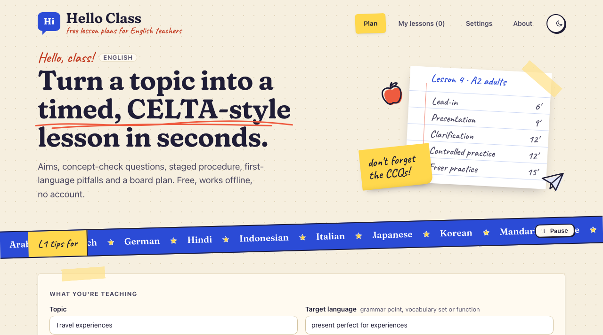
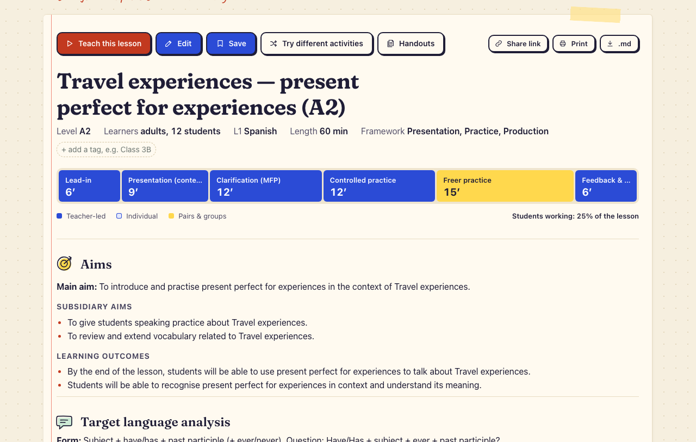
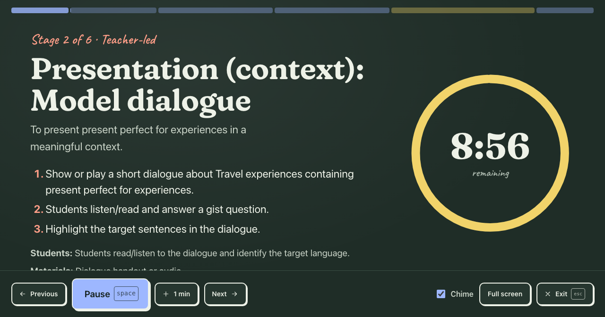
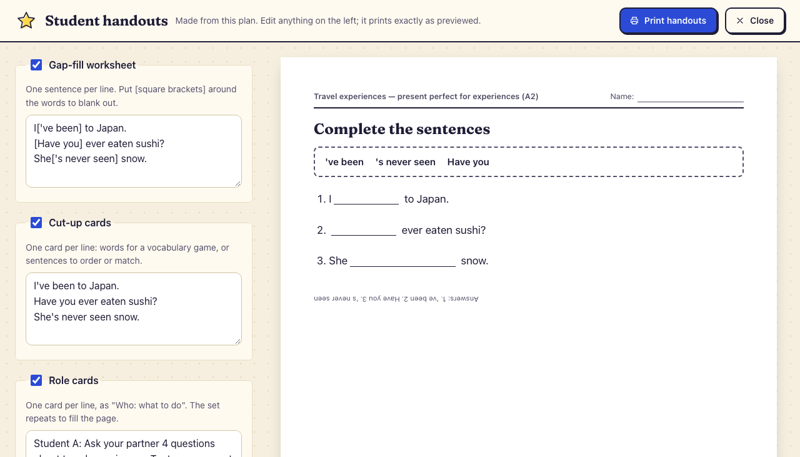
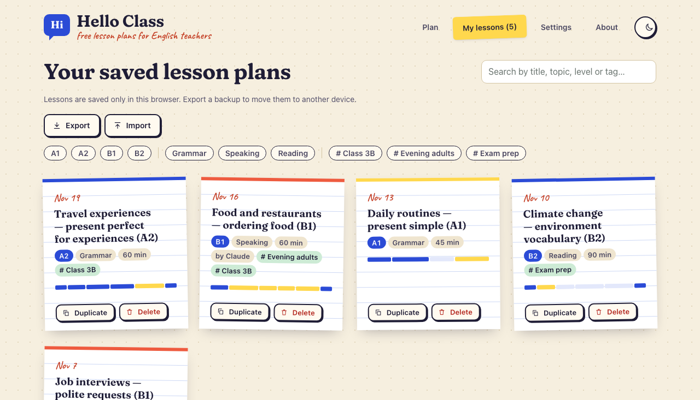
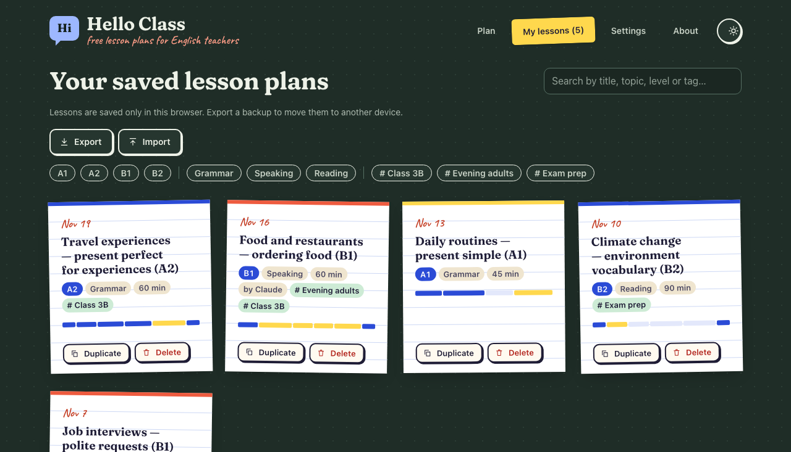

# Hello Class

**A free lesson planner for teachers of English as a second or foreign language.**
Turn a topic into a timed, CELTA-style lesson in seconds, then teach it, print it, or hand it out.

**[Open Hello Class →](https://prestoj01.github.io/teaching-english-planner/)**  ·  no account, works offline, free forever

*Made by [Preston](https://github.com/Prestoj01).*



## What it does

Enter a topic, target language, CEFR level and your learners' first language. You get a complete,
editable plan in the format used on CELTA and TEFL courses:

- **Aims and learning outcomes**
- **Target language analysis**: form, meaning, pronunciation, examples and concept-check questions (CCQs)
- **Timed stages** with interaction patterns, teacher procedure, student activity and materials, using PPP,
  Test-Teach-Test, Task-Based Learning, ESA, or Pre/During/Post for reading and listening
- **A lesson timeline** that shows each stage's share of the time and how much of the lesson students spend working
- **Anticipated problems and solutions** based on the learners' first language (15+ languages)
- **Differentiation** (support and stretch), a **board plan** and **homework**

| | |
|---|---|
|  **The plan.** Edit anything in place, drag stages into a new order, add or delete stages, and undo. |  **Classroom mode.** Teach from a full-screen view, one stage at a time, with a countdown and a soft chime for each stage. |
|  **Student handouts.** A gap-fill, cut-up cards, role cards and exit tickets are built from the plan. Edit them, then print. |  **Your library.** Saved lessons are index cards you can search, filter by level, focus or your own tags, and back up. |

Plans can also be **shared by link** (the whole plan is compressed into the URL, so there's still no server),
**printed or saved as PDF** on a clean A4 layout, and downloaded as Markdown. There's a **chalkboard (dark) mode**, too.



## Why I built this

I work in AI and data engineering and I'm training to teach English abroad. Planning a CELTA-style lesson
well takes a long time: you need aims, CCQs, timings that add up, and the mistakes your particular learners
are likely to make. Hello Class is the tool I wanted for that. It joins the job I do now to the one I'm moving
into, and it's built so it can stay free for every teacher who uses it.

## Free forever, by design

| Concern | How it's handled |
|---|---|
| Hosting | Static site on GitHub Pages: no server, no database, $0 to run |
| Accounts and data | None. Plans are stored in the browser's `localStorage`; export and import for backups |
| Sharing | Share links carry the plan inside the URL fragment, which is never sent to any server |
| Core features | The offline generator runs fully in the browser from a curated knowledge base |
| AI features | Optional, **bring your own key**. The teacher's Claude API key stays in their browser and calls go straight to Anthropic, so the project owner never pays for usage |
| Feedback | "Suggest an activity" opens a pre-filled GitHub issue. No analytics, no tracking |

## How it works

```
LessonRequest ──► Template generator (offline, deterministic) ──┐
      │                                                        ├──► LessonContent (Zod schema) ──► Plan / Classroom / Handouts / Library / Export
      └─────────► Claude generator (optional, BYOK) ───────────┘
```

- **One schema, two generators.** [`src/schema.ts`](src/schema.ts) defines the plan with Zod. The template
  generator produces it directly. The AI generator asks Claude for the same schema through
  [structured outputs](https://platform.claude.com/docs/), so the response is validated before it reaches
  the UI. The rest of the app never needs to know where a plan came from.
- **Template generator** ([`src/generator/templateGenerator.ts`](src/generator/templateGenerator.ts)):
  - assigns stage timings by framework weights, so they always add up exactly to the lesson length
  - chooses activities from a bank that's filtered by level, age group and focus, using a seeded PRNG so
    results are reproducible ("Try different activities" changes the seed)
  - adds a full language analysis for common grammar points, and problems specific to the learners' L1
- **AI generator** ([`src/ai/claudeGenerator.ts`](src/ai/claudeGenerator.ts)): uses the Anthropic TypeScript SDK
  with structured output, adaptive thinking and server-side refusal fallbacks. The template plan's stage
  skeleton and the L1 notes are passed in as grounding. The SDK is lazy-loaded, so people who don't use AI
  never download it.
- **Handouts** ([`src/handouts.ts`](src/handouts.ts)): pure functions that turn a plan into worksheets. They
  suggest gaps (key vocabulary first, then an auxiliary + verb chunk such as *'ve been*, then the longest
  word), and rewrite learning outcomes as "I can…" statements.
- **Share links** ([`src/share.ts`](src/share.ts)): `deflate-raw` + base64url into `#share=…`, about 3 KB for
  a typical plan, validated against the schema when it's opened.
- **Knowledge base** ([`src/data/`](src/data/)): frameworks, activities, grammar points and L1 interference notes,
  stored as plain typed data that's easy to extend.

## Design notes

- **A design system in one file.** Colour, type, space, radius and shadow tokens live at the top of
  [`src/index.css`](src/index.css). Chalkboard mode swaps the colour tokens; "paper" items (cards, sticky
  notes) keep the light palette, like notes pinned to a board.
- **The teacher's-desk look**: Fraunces and Caveat fonts bundled with the site (no Google Fonts request),
  hand-drawn SVG doodles in one consistent style, masking tape, index cards and a red-pen underline.
- **Motion with a purpose.** Sections reveal as you scroll, the timeline grows in, and the greeting cycles
  through 14 languages. A pause button stops the moving content, and all motion switches off for people who
  set their system to reduce motion.
- **Accessible by default.** WCAG AA contrast in both themes, a skip link, focus traps in full-screen panels,
  live-region announcements in classroom mode, and keyboard alternatives for drag-and-drop.

## Development

```bash
npm install
npm run dev      # http://localhost:5173
npm test         # Vitest unit and render tests
npm run lint
npm run build    # static site in dist/
```

The social preview image is generated from [`design/og-image.html`](design/og-image.html); the command is at
the bottom of that file.

## Deploying

Pushing to `main` runs lint, tests and build, then deploys to GitHub Pages through
[`.github/workflows/deploy.yml`](.github/workflows/deploy.yml). One-time setup: in the repo, go to
**Settings → Pages → Source** and choose **GitHub Actions**.

## Roadmap ideas

- More grammar points, activities and L1 profiles (suggestions welcome: use "Suggest an activity" in the app)
- Unit/term planning: sequence several lessons with recycled vocabulary
- An eval set to compare AI plan quality across models and prompts
- Install as an app (PWA) for fully offline use

## License

MIT
